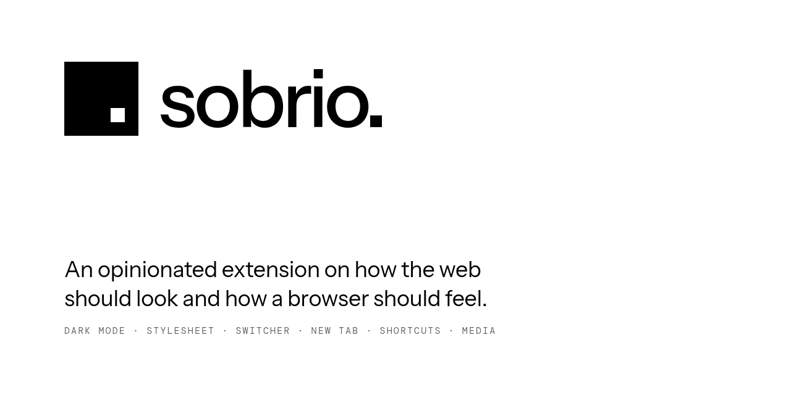
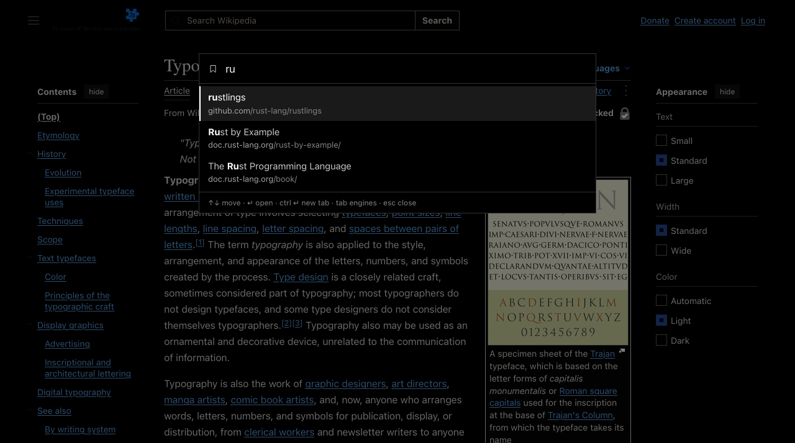
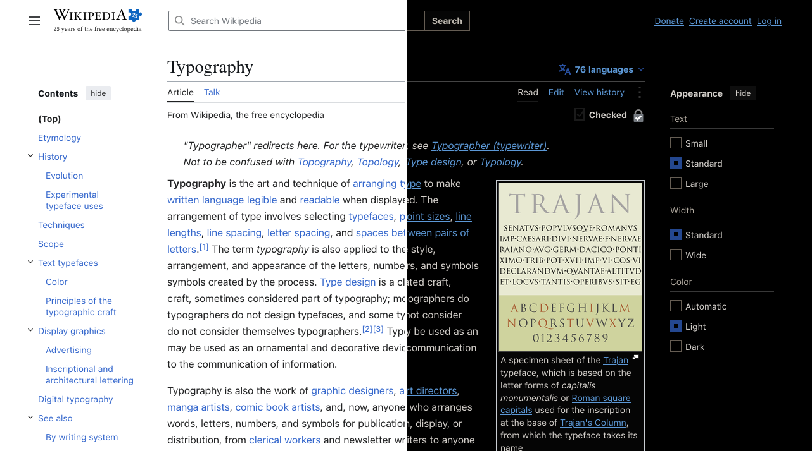
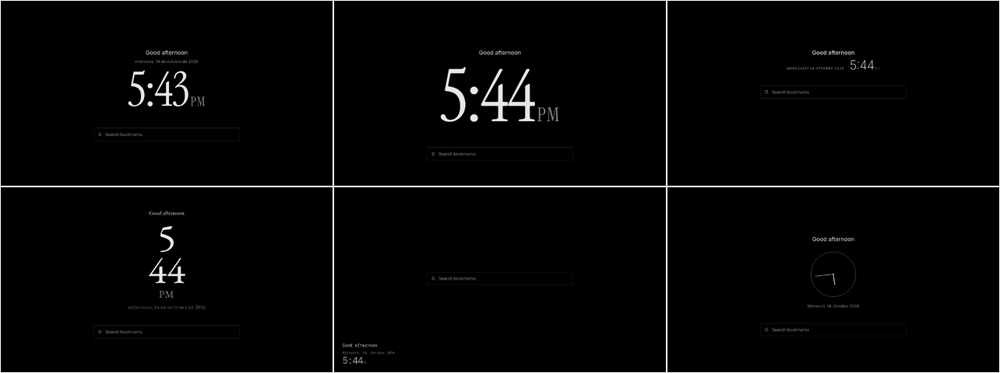
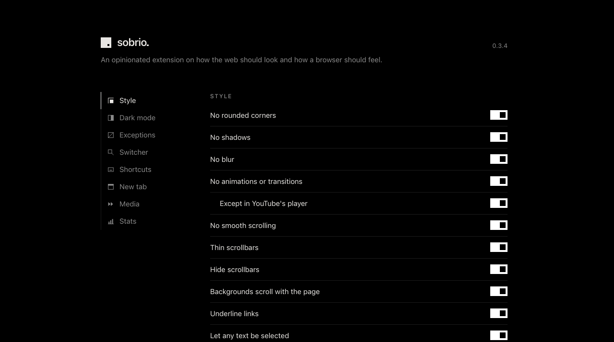

<p align="center">
  <picture>
    <source media="(prefers-color-scheme: dark)" srcset="docs/brand/banner-dark.png">
    
  </picture>
</p>

<p align="center">
  <a href="#ne-yapar">Ne yapar</a> ·
  <a href="#ayarlar">Ayarlar</a> ·
  <a href="#kurulum">Kurulum</a> ·
  <a href="#geliştirme">Geliştirme</a>
</p>

<p align="center"><sub>
  <a href="README.md">English</a> ·
  <a href="README.es.md">Español</a> ·
  <a href="README.de.md">Deutsch</a> ·
  <a href="README.fr.md">Français</a> ·
  <a href="README.it.md">Italiano</a> ·
  <a href="README.pt-BR.md">Português (Brasil)</a> ·
  <a href="README.nl.md">Nederlands</a> ·
  <a href="README.sv.md">Svenska</a> ·
  <a href="README.pl.md">Polski</a> ·
  <a href="README.cs.md">Čeština</a> ·
  <a href="README.hu.md">Magyar</a> ·
  <a href="README.ro.md">Română</a> ·
  <b>Türkçe</b> ·
  <a href="README.ru.md">Русский</a> ·
  <a href="README.uk.md">Українська</a> ·
  <a href="README.id.md">Bahasa Indonesia</a> ·
  <a href="README.vi.md">Tiếng Việt</a> ·
  <a href="README.ja.md">日本語</a> ·
  <a href="README.ko.md">한국어</a> ·
  <a href="README.zh-CN.md">简体中文</a> ·
  <a href="README.zh-TW.md">繁體中文</a>
</sub></p>

sobrio, [Stylus](https://github.com/openstyles/stylus), [Dark Reader](https://github.com/darkreader/darkreader), [Search Bookmarks, History and Tabs](https://github.com/Fannon/search-bookmarks-history-and-tabs), [Tabliss](https://github.com/joelshepherd/tabliss) ve [Global Speed](https://github.com/polywock/globalSpeed)'den küçük bir parça alır, başka hiçbir şey almaz. Firefox, LibreWolf ve Chrome için tek bir eklenti: iki renk, yuvarlak köşe yok ve hiçbir şey tarayıcınızdan çıkmaz.



## Ne yapar

### Tek bir stil sayfası, her yerde

Yuvarlak köşe, gölge, metin gölgesi ya da bulanıklık yok. Animasyonlar ve geçişler, YouTube oynatıcısı hariç, tamamen kesilir. Kaydırma çubuğu yok, yumuşak kaydırma yok; arka planlar sayfayla birlikte kayar. Bağlantılar altı çizili, her metin seçilebilir, CSS ile zorlanmış büyük harf yok.

Her parça ayarlardaki bir anahtardır (kaydırma çubuğu yerine ince olanlar da dahil); ikisi kapalı başlar: resimler ve videolar gri tonlamada, bir de görünür bir odak çerçevesi. Bunların altında, kendi CSS'iniz için bir kutu var (en fazla 50.000 karakter). Her sitede sobrio'nunkinden sonra, ayrı bir sayfada yer alır; böylece en üste yazılan bir `@import` çalışır.

### Koyu, akıllıca



Dark Reader'ın dinamik motoru her siteyi renk renk siyaha (`#000`) çevirir. Kendi koyu teması olan siteler onu korur. Parlaklık, kontrast, sepya, gri tonlama ve renkler ayarlardadır; zamanlama yoktur.

### Switcher

<kbd>Ctrl</kbd>+<kbd>Space</kbd> sayfanın ortasında bir kutu açar, Obsidian'ın hızlı geçiş kutusu gibi. Yer imlerinizde aramak için yazın; ne kadar esnek olacağı bir ayardır (katı, normal ya da esnek). Hiçbir şey eşleşmezse <kbd>Enter</kbd> webde arar. <kbd>Tab</kbd> Google, DuckDuckGo, YouTube, Wikipedia, GitHub ve kendi arama motorlarınız arasında gezer (`%s` içeren herhangi bir adres, örneğin bir SearXNG örneği); varsayılan arama motoru ilk sırada gelir. Bu parçaların her biri kapatılabilir.

Switcher'dan açtıklarınızı hatırlar: sık açtığınız ve yakın zamanda açtığınız bir yer imi sonuçlarda yükselir. Ayarlardaki İstatistikler sekmesi her sayfanın kaç kez açıldığını ve ağırlığını gösterir; birini ya da hepsini sıfırlayabilirsiniz.

| Tuş | |
|---|---|
| <kbd>↓</kbd> <kbd>Ctrl</kbd>+<kbd>J</kbd> / <kbd>↑</kbd> <kbd>Ctrl</kbd>+<kbd>K</kbd> | taşı |
| <kbd>Enter</kbd> | burada aç |
| <kbd>Ctrl</kbd>/<kbd>Alt</kbd>+<kbd>Enter</kbd> | yeni sekmede aç |
| <kbd>Tab</kbd> / <kbd>Shift</kbd>+<kbd>Tab</kbd> | sonraki / önceki arama motoru |
| <kbd>Esc</kbd> | kapat |

Switcher'a yazılan üç komut. Araç çubuğu düğmesinden de çalışırlar, etkin sekmenin sitesinde. Kelimeleri Ayarlar › Switcher'dan değiştirilebilir:

| Komut | |
|---|---|
| `td` | geçerli site için karanlık modu aç ya da kapat |
| `ta` | geçerli site için stil sayfasını aç ya da kapat |
| `settings` | ayarlar (`options` de çalışır) |

### Yeni sekme



Tarih ve saat, özenle düzenlenmiş; altlarında switcher. Altı düzen: klasik, yalnızca saat, tek satır, üst üste (saat ve dakika alt alta), köşe ve sade bir analog saat. Dört tipografik stil: Editoryal (Instrument Serif ve Inter), İsviçre (Inter), Makine (IBM Plex Mono) ve Kitap (EB Garamond), ya da makineye kurulu kendi yazı tipleriniz. İsteğe bağlı bir selamlama, adınızla. Bir dil listesi verirseniz her yeni sekme tarihi bunlardan birinde, rastgele söyler. Firefox ve LibreWolf'ta yeni sekme aynı zamanda başlangıç sayfasıdır: tarayıcı onunla açılır, her yeni pencere de onunla açılır.

Tarayıcılar yeni bir sekmede odağı adres çubuğunda tutar ve hiçbir eklenti onu oradan alamaz. Switcher'a hemen yazabilmeniz için sekme, aynı yerde odaklanmış yeni bir sekmeyle değiştirilir; adres çubuğu da boş kalmak yerine sayfanın adresini gösterir. Firefox kapsayıcı sekmesinde bu olduğu gibi kalır. Tarayıcının kendi yolunu tercih ediyorsanız *Odağı adres çubuğundan al* seçeneğini kapatın.

### Medya hızı

Her video ve ses, ayarladığınız hızda ya da sitenin kendi kuralındaki hızda oynar. <kbd>]</kbd> hızlandırır, <kbd>[</kbd> yavaşlatır, <kbd>\\</kbd> 1×'e döndürür. 0,91× ile 1,09× arasındaki her hız 1× sayılır. Hızı sitenin kendi denetimleriyle değiştirirseniz sobrio o sayfada dokunmaz. İsteğe bağlı olarak, dokunmadan önce ses çalmaya başlayan video ve sesler duraklatılır; sessiz olanlar oynamaya devam eder.

### Kendi kısayollarınız

Ayarlarda bir tuş kombinasyonu kaydedin ve ne yapacağını seçin: switcher'ı açmak, bir arama motorunda aramak (ya da seçili metni aramak), sitede karanlık modu ya da stil sayfasını değiştirmek, her yerde karanlık mod, burada ya da yeni sekmede bir adres açmak, medya hızını ayarlamak, sayfanın bağlantısını izleme parametreleri (`utm_*`, `fbclid`, `gclid` ve benzerleri) olmadan kopyalamak ya da ayarları açmak. <kbd>Ctrl</kbd>, <kbd>Alt</kbd> ya da <kbd>Meta</kbd> ya da bir işlev tuşu gerekir. Gömülü bir çerçevenin içindeyken de çalışırlar (Google Dokümanlar, bir video oynatıcı) ve her zaman adres çubuğundaki siteye uygulanırlar.

## Ayarlar



Switcher'da `settings` yazarak ya da `about:addons` / `chrome://extensions` içindeki eklenti tercihlerinden açın. Her bölüm için bir sekme: Stil, Karanlık mod, İstisnalar, Switcher, Kısayollar, Yeni sekme, Medya ve İstatistikler. Her değişiklik kendiliğinden kaydedilir ve açık sekmelere hemen uygulanır.

Her sekmenin altındaki yedekleme, her şeyi (ayarlar, istisnalar, kısayollar ve switcher'ın hafızası) bir dosyaya kaydeder ve başka bir tarayıcıda geri yükler. Eklenti yüklendiğinde bir kez açılan karşılama rehberi de buradadır.

Yerel adresler (`localhost`, `127.0.0.1`, `192.168.x`, `.local` adları ve makinenizin ya da ağınızın geri kalanı) varsayılan olarak olduğu gibi bırakılır; böylece kendi işleriniz olduğu gibi görünür. İstisnalar sekmesinin en üstündeki anahtar bunu değiştirir.

İstisnalar siteleri `example.com` (yalnızca o site) ya da `*.example.com` (site ve alt alan adları) olarak alır; stil sayfası ve karanlık mod için ayrı ayrı. Üçüncü bir liste, bir sitenin kendi animasyon ve geçişlerini korur; geri kalan stil sayfası uygulanmaya devam eder. Bu liste `chatgpt.com` ile başlar; animasyonları kesilirse yazarken görünümü kaydığı için.

### `userContent.css` dosyasından temalandırma

Firefox ve LibreWolf'ta sobrio, bu değişkenleri `userContent.css` dosyasından okur (`toolkit.legacyUserProfileCustomizations.stylesheets` açıkken) ve bunları karanlık mod, switcher, ayarlar ve yeni sekme için kullanır. Ayarlardaki renklerin önüne geçerler. `@-moz-document` kuralı bunları yalnızca eklenti sayfalarında tutar: hiçbir web sitesi bunları görmez.

```css
@-moz-document url-prefix("moz-extension://") {
  :root {
    --sobrio-background: #07090f;   /* dark mode, switcher and new tab background */
    --sobrio-text: #edf1ff;
    --sobrio-text-muted: #7c86a0;
    --sobrio-selection: #171d2b;    /* the selected row, and selected text */
    --sobrio-border: #4a5470;
    --sobrio-accent: #f5a9cf;       /* the selection bar and the matched letters */
    --sobrio-corners: square;       /* square or round: overrides the corners switch */
    --sobrio-font: "SF Pro Text";   /* optional: a font installed on this machine */
  }
}
```

Tarayıcı `userContent.css` dosyasını başlangıçta okur, bu yüzden değişiklikler yeniden başlattıktan sonra görünür.

## Kurulum

- **Chrome:** `chrome://extensions` adresini açın, *Geliştirici modu*nu açın, *Paketlenmemiş öğe yükle*ye tıklayın ve bu klasörü seçin.
- **LibreWolf:** `about:config` içinde `xpinstall.signatures.required` değerini `false` yapın, `scripts/pack.sh` komutunu çalıştırın ve `about:addons` içinden `dist/sobrio-<version>.xpi` dosyasını açın (*Dosyadan eklenti yükle*). Hızlıca denemek için `about:debugging` › *Geçici eklenti yükle* bu ayara gerek kalmadan çalışır.
- **Firefox:** Sürüm derlemeleri yalnızca imzalı eklentileri yükler. Zip dosyasını [addons.mozilla.org](https://addons.mozilla.org/developers/) adresine *listelenmemiş* olarak yükleyin; kendiniz için imzalatmış olursunuz.

Firefox, eklentinin ayarladığı yeni sekmeyi tutup tutmayacağınızı bir kez sorar; tutun. Kısayol `about:addons` › *Eklenti kısayollarını yönet* ya da `chrome://extensions/shortcuts` üzerinden değiştirilebilir.

Eklentilerin çalışamadığı sayfalarda (`about:` ve `chrome://` sayfaları, eklenti mağazaları, PDF'ler) kısayol bunun yerine araç çubuğu düğmesinden switcher'ı açar. Araç çubuğu düğmesi her zaman onu açar. Firefox'ta birkaç sayfa çok geç tanınır (adresinde `.pdf` olmayan bir PDF, hata sayfaları): orada kısayol bir şey yapmaz, araç çubuğu düğmesi yine çalışır.

**İpucu:** Tarayıcınızı ya da sisteminizi koyu bir görünüme ayarlayın. Kendi koyu teması olan siteler (GitHub, YouTube ve daha birçok site) ona geçer ve sobrio onları olduğu gibi bırakır.

## Geliştirme

Derleme adımı ve npm bağımlılığı yok.

```sh
node --test                                   # unit tests
python3 -I tools/marionette.py . <url>...     # headless LibreWolf/Firefox with sobrio loaded
python3 -I tools/cdp.py . <url>...            # headless Chromium with sobrio loaded
python3 -I tools/vendor-darkreader.py 4.9.133 # update the bundled Dark Reader
python3 -I tools/vendor-fonts.py              # update the bundled fonts
python3 -I tools/make-icons.py                # redraw the icons from the isotype's grid
scripts/pack.sh                               # dist/sobrio-<version>.zip and .xpi
```

Sürümü çıkarmak için `manifest.json` içindeki sürümü artırın, commit yapın ve `v<version>` etiketini gönderin. Yayın iş akışı testleri çalıştırır, paketler ve bir GitHub sürümü yayımlar (zip ve xpi ile). Depo değişkeni `AMO_PUBLISH` `true` ise xpi dosyasını addons.mozilla.org'a gönderir (`AMO_JWT_ISSUER` ve `AMO_JWT_SECRET` gizli anahtarlarıyla).

Marka (izotip, iki renk, yazı tipi ve simgeler) [docs/brand](docs/brand/README.md) içinde.

## Lisans

MIT. Dark Reader'ı (MIT) ve dört yazı tipini SIL Açık Yazı Tipi Lisansı altında içerir: bkz. [THIRD_PARTY_NOTICES.md](THIRD_PARTY_NOTICES.md).
